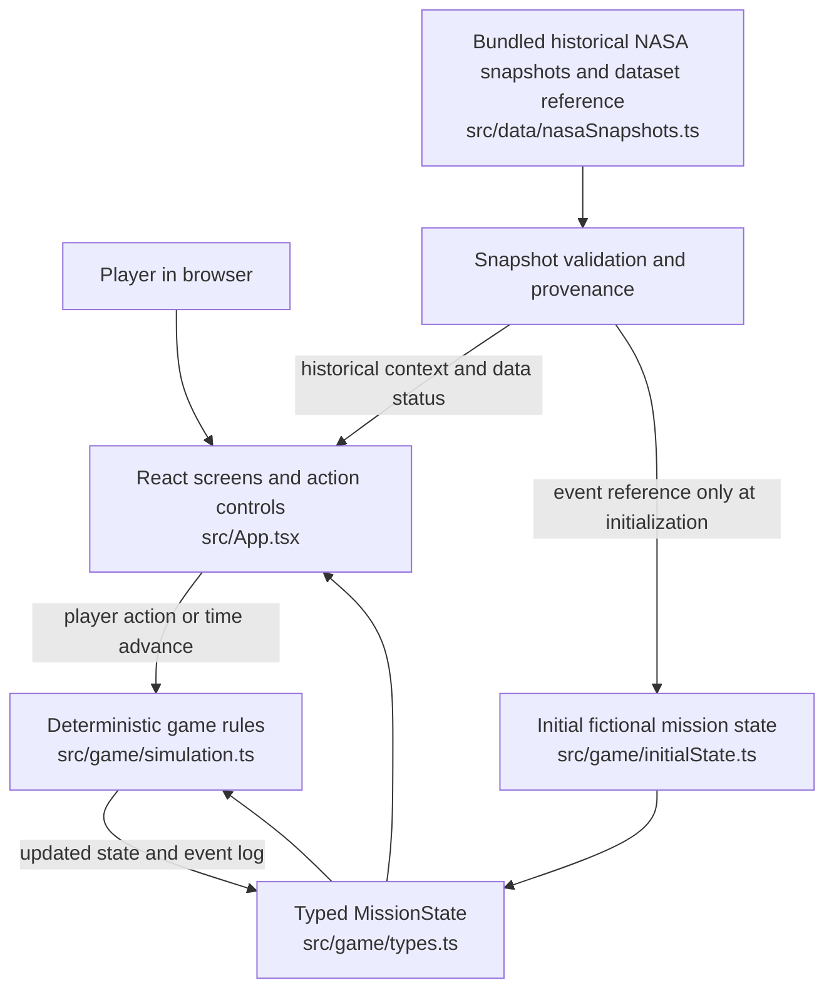
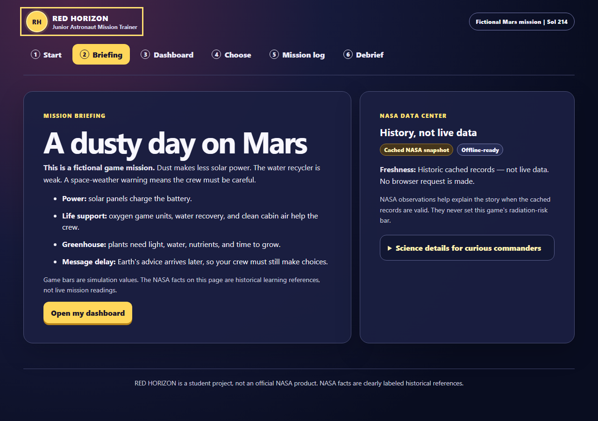
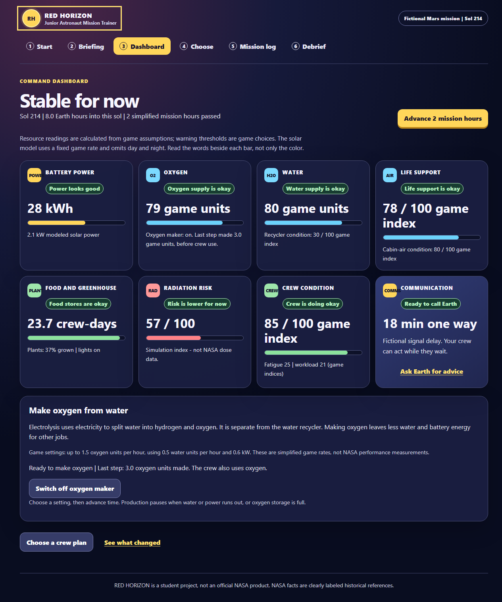
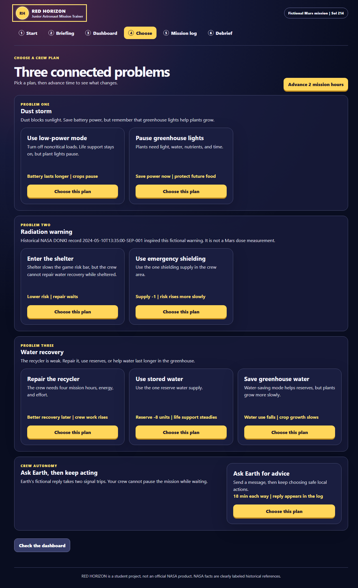
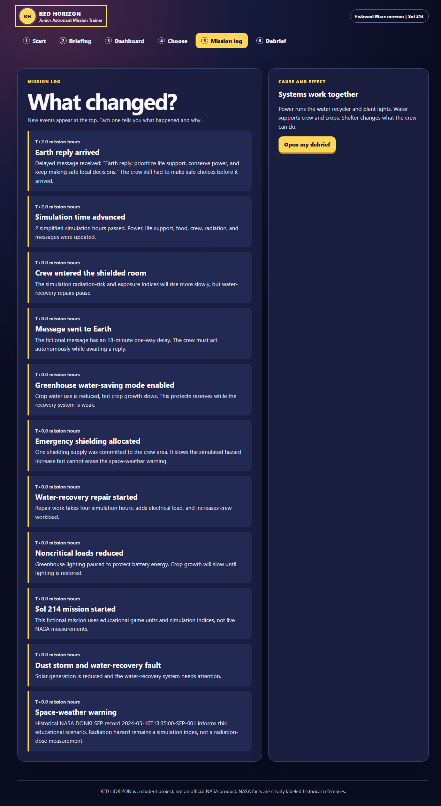
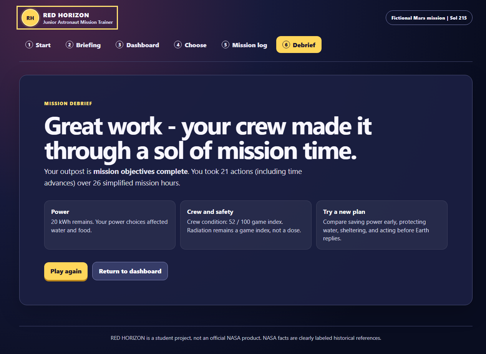
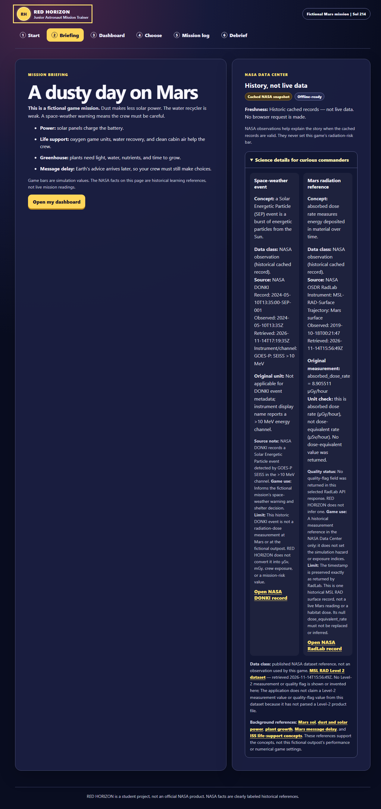

# RED HORIZON — Junior Astronaut Mission Trainer

**Live application:** **TODO — add the verified deployed URL here before the 15 November 2026, 2:00 PM IST code freeze.** A hosted URL has not been verified in this repository.

**NASA Space Apps Challenge 2026:** [Build a Junior Astronaut Mission Trainer](https://www.spaceappschallenge.org/2026/challenges/junior-astronaut-mission-trainer/)

> Student-built hackathon project. Not an official NASA product and not endorsed by NASA.

## 1. Project Title & Problem Statement

**RED HORIZON** is a browser game for children aged 7–12. Space outposts need power, breathable air, water, food, radiation protection, and contact with Earth. Those needs affect one another: saving electricity can slow crops, while sheltering can delay a repair. The player makes choices in a fictional Mars mission, advances time, and sees the consequences. The official challenge is **Build a Junior Astronaut Mission Trainer**.

## 2. Team Details

**Team name:** Maverick

| Full name | Home institution | GitHub username | Engineering/design role | Actual individual contributions |
|---|---|---|---|---|
| Ashwin Pal | G.H. Raisoni College of Engineering, Nagpur | [ash242222-beep](https://github.com/ash242222-beep) | Application integration and test commits, per Git history; **TODO — confirm role** | Commits include `src/App.tsx`, `src/styles.css`, `src/game/`, `src/data/`, and test changes. **TODO — describe actual manual engineering and review.** |
| Gaurav Panchtilak | G.H. Raisoni College of Engineering, Nagpur | [gauravpanchtilak16](https://github.com/gauravpanchtilak16) | Initial repository setup, per Git history; **TODO — confirm role** | Initial README commit and two empty placeholder files (`index.html`, `style.css`) in the recorded history. **TODO — describe any further work.** |

The names, institution, and usernames were supplied by the team. Git history supports the listed commit areas; it does not establish who wrote underlying content, each person's final role, or what they manually reviewed.

## 3. Solution Overview & Architecture

### The playable mission

**Sol 214: Outpost Survival** starts with a Martian dust storm, a water-recovery fault, and a fictional radiation warning informed by a *historical* NASA space-weather event. The six screens are mission intro, briefing, dashboard, decision panel, consequence log, and debrief. Players can reduce electrical loads, change greenhouse lighting and water use, repair or draw on water reserves, shelter or allocate shielding, and ask Earth for advice. Advancing time applies resource use, delayed crop growth, repair progress, crew effects, and queued messages to one mission state. The mission can succeed or fail and can be replayed from its starting state.

The five connected game systems are **power** (solar generation, loads, battery), **life support** (oxygen inventory and generation, water recovery, cabin-air condition), **food** (stored food and time-dependent crops), **radiation risk** (unitless game indices and shielding choices), and **communications** (one-way signal delay and a later reply). From the dashboard, players can switch an oxygen maker on or off. It makes oxygen over elapsed mission time using water and electricity; crew oxygen consumption continues. All resource thresholds and outpost rates are game assumptions, not NASA measurements. The solar model uses a fixed game rate and omits day and night.

The oxygen maker illustrates **water electrolysis**: electrical energy splits water into hydrogen and oxygen (`2 H₂O → 2 H₂ + O₂`). It is separate from water recovery. Its maximum rates are **1.5 oxygen game units/hour**, **0.5 water game units/hour**, and **0.6 kW** while running. These are gameplay settings, not measured spacecraft efficiency or physical mass ratios. The model reserves water for crew/crops and energy for existing loads first, limits production to available water, electricity, and oxygen capacity, and pauses when supplies are unavailable or oxygen storage starts a turn full. Newly recovered water becomes available to the generator on the following turn. The mission log records production and costs. Poor cabin-air condition reduces life-support health; a zero cabin-air game index ends the mission.

Turns advance by **two simplified mission hours**. A Martian sol is modeled as **24 hours, 39 minutes, 35 seconds**; the two-hour turn size means the one-sol objective is evaluated at the first turn beyond that duration (26 elapsed hours). The dashboard tracks the sol number and time within the sol separately from elapsed mission time. The scenario's **18-minute one-way** Earth–Mars delay is a game assumption; messages remain available, so delay is not a blackout.

### Architecture



The NASA observations do **not** supply the radiation-risk index or a fictional habitat dose. There is no runtime NASA API request: the app checks the structure of its bundled snapshots, allows offline play, and labels the records as historical cached data. That structural check does not independently authenticate a NASA observation. There is no private API key in the client and no account or environment variable is required to run it.

### Technology stack

| Layer | Implementation |
|---|---|
| Frontend | React 18, Vite 5 |
| Language | TypeScript 5 |
| Styling | Repository CSS (`src/styles.css`) |
| Simulation | Deterministic TypeScript state transitions in `src/game/simulation.ts` |
| NASA data | Static, attributed snapshots and validation in `src/data/nasaSnapshots.ts` |
| Tests | Vitest 2; headless Chromium used for a local browser check |
| Hosting | **TODO — verify and add the actual deployed host and URL** |

### NASA data and scientific limits

The dates and fields below are the original provenance stored in the repository's cached snapshots. During repository recovery on 15 November 2026 IST, the RadLab endpoint returned the same timestamp, instrument, Mars-surface trajectory, value, and null dose-equivalent field. A DONKI recheck returned HTTP 429; its historical cache was retained without changing its original retrieval timestamp. Verification does not make either record a current observation.

| Classification and source | Stored observation / retrieval | Original field and unit | Use and limit |
|---|---|---|---|
| **NASA observation, historical cached:** [NASA DONKI Solar Energetic Particle (SEP) API](https://api.nasa.gov/DONKI/SEP); [event detail](https://ccmc.gsfc.nasa.gov/DONKI/view/SEP/30677/-1). Record `2024-05-10T13:35:00-SEP-001`, GOES-P SEISS `>10 MeV` channel. | Event `2024-05-10T13:35Z`; retrieved `2026-11-14T17:19:35Z`. | Event metadata; **no dose unit**. `>10 MeV` identifies an instrument energy channel. | Informs the fictional warning and shelter choice. It is **not** a measured Mars-surface or habitat dose and is never converted into the game hazard index. |
| **NASA observation, historical cached:** [NASA OSDR RadLab Mars-surface query](https://visualization.osdr.nasa.gov/radlab/api/?trajectory=Mars%20surface&timestamp%3E=2019-10-18T00%3A00&timestamp%3C2019-10-18T00%3A30&absorbed_dose_rate&dose_equivalent_rate&format=json), instrument `MSL-RAD-Surface`. No row identifier was returned. | Timestamp `2019-10-18T00:21:47` as returned; retrieved `2026-11-14T15:56:49Z`. | `absorbed_dose_rate = 8.905511 µGy/hour`. `dose_equivalent_rate` was null; no quality-flag field was returned in the selected response. | Historical science reference in the NASA Data Center only. **µGy/hour is not µSv/hour.** One historical surface measurement is neither a live reading nor a dose at this fictional outpost. |
| **NASA dataset reference, not an extracted row:** [MSL RAD Level-2 observation dosimetry](https://data.nasa.gov/dataset/mars-science-laboratory-msl-radiation-assessment-detector-rad-level-2-observation-dosimetr-e2695), [DOI 10.48322/20qb-4e17](https://doi.org/10.48322/20qb-4e17). | Landing page retrieved `2026-11-14T15:56:49Z`; no individual observation date is claimed. | No Level-2 measurement or unit is displayed from this dataset. | Provides dataset and quality-flag context; the app has not parsed a Level-2 product or assigned a quality flag to the RadLab row. |
| **Derived game calculation** | Each simulated time advance. | Battery energy change = `(solar generation kW − active load kW) × elapsed hours`, in **kWh**. | A calculation using fictional outpost settings, not an observed NASA power reading. |
| **Game assumptions** | Fictional Sol 214 mission. | Oxygen and water in game units, food in crew-days, radiation and crew condition in unitless game indices, 18-minute one-way message delay. | Determine gameplay only; these are not medical thresholds, measured Mars conditions, or NASA performance predictions. |

[NASA's RadLab API documentation](https://visualization.osdr.nasa.gov/radlab/gui/data-api/) explains the radiation fields and units. [NASA's Mars communications explainer](https://www.nasa.gov/missions/tech-demonstration/space-communications-7-things-you-need-to-know/), [Mars dust and solar-power report](https://www.nasa.gov/solar-system/nasas-insight-sees-power-levels-stabilize-after-dust-storm/), [plant-growth reference](https://www.nasa.gov/exploration-research-and-technology/growing-plants-in-space/), and [ISS life-support overview](https://www.nasa.gov/reference/environmental-control-and-life-support-systems-eclss/) support the concepts. They do not establish the fictional outpost's numerical rates, crop yield, or Mars water-recovery performance. See [SCIENCE_AND_DATA_REGISTER.md](SCIENCE_AND_DATA_REGISTER.md) for provenance and further limits.

## 4. Live Demo & Screenshots

- **Live application:** **TODO — insert a verified deployed URL.** No deployment is established by the files in this repository.
- **Demo video:** Not available / not verified.
- **Local demo:** follow the installation steps below and open the URL Vite prints.

These are actual captures of the locally built application in headless Chromium; they are not generated illustrations. The dashboard capture shows oxygen production after a time advance. The debrief image shows one successful playthrough.

| Screen | Screenshot |
|---|---|
| Mission briefing |  |
| Command dashboard |  |
| Decision panel |  |
| Consequence log |  |
| Mission debrief |  |
| NASA Data Center details |  |

## 5. Installation & Setup Guide

These steps were checked against the repository's `package.json`. The local verification environment was **Node.js v24.19.0** and **npm 11.17.0** on Windows. Other versions or operating systems were not independently tested for this README.

```bash
git clone https://github.com/gauravpanchtilak16/RED-HORIZON.git
cd RED-HORIZON
npm ci
npm run dev
```

Open the local address printed by Vite (typically `http://localhost:5173/`). The clone URL matches the configured Git remote; public reachability could not be verified from this environment. If the repository is already downloaded, run the npm commands from the folder containing `package.json`. On Windows PowerShell, `npm.cmd` can be used in place of `npm` if script execution policy blocks `npm.ps1`.

For tests and a production bundle:

```bash
npm run test
npm run build
npm run preview
```

`npm run build` writes to `dist/`; `npm run preview` serves that bundle locally and prints its URL. The application makes no browser request to NASA and needs no API key or other environment configuration. The bundled records remain historical snapshots even when the browser is online.

## 6. AI Usage Disclosure

**OpenAI Codex in the ChatGPT desktop app was used during RED HORIZON development.** The disclosure below covers assistance visible in this project work. A separate ChatGPT workflow is not evidenced here. **TODO — team to confirm whether separate ChatGPT sessions or any other AI tools were used and add them here before submission.** Do not attribute other tools without evidence.

| AI tool | Exact files, sections, or assets assisted | Nature of assistance | Human engineering, review, integration, and testing |
|---|---|---|---|
| OpenAI Codex (ChatGPT desktop app) | `src/App.tsx`, `src/styles.css`, `src/game/types.ts`, `src/game/initialState.ts`, `src/game/simulation.ts`, `src/data/nasaSnapshots.ts`, `src/game/__tests__/simulation.test.ts`, `src/data/__tests__/nasaSnapshots.test.ts`, `src/data/__tests__/nasaFallback.test.ts`, this `README.md`, and the six browser captures under `docs/screenshots/`. | Assisted with application scaffold and mission logic, NASA source investigation and provenance labels, UI language and styling, debugging and QA, test code, documentation, and automated browser captures. The screenshots record the rendered app; they are not AI-generated art. | The supplied team members own the project and all Git operations. Codex ran automated tests, builds, and a local headless browser check; those do **not** prove human review. **TODO — Ashwin and Gaurav: record your actual engineering contributions, manual review, integration, and tests, with the files or features each of you handled.** |

**AI-assisted assets:** `public/favicon.svg` is a simple RH monogram written as SVG code with Codex assistance; `index.html` links it. The six PNG images above are browser screenshots of the running application. No AI-generated raster illustration, audio, or video is included. **AI-assisted copy and design:** mission text, scientific labels, CSS/UI decisions, and README wording were assisted by Codex; they require human review before submission.

**Recovery assistance:** On 15 November 2026, the team explicitly authorized Codex to restore the displaced repository files, implement and test oxygen generation, connect cabin-air depletion to survival, refresh browser captures, and run commit/push commands using the existing configured human Git identity. This authorization superseded the earlier instruction that humans execute every Git command. It does not establish organizer approval of that workflow or prove human review of AI output. The recovery changes include `src/game/__tests__/oxygenGeneration.test.ts`, `.gitignore`, the game/UI files listed above, scientific documentation, and the favicon. AI authors and AI co-author trailers must not be added; the team must confirm its actual review and handbook compliance before submission.
