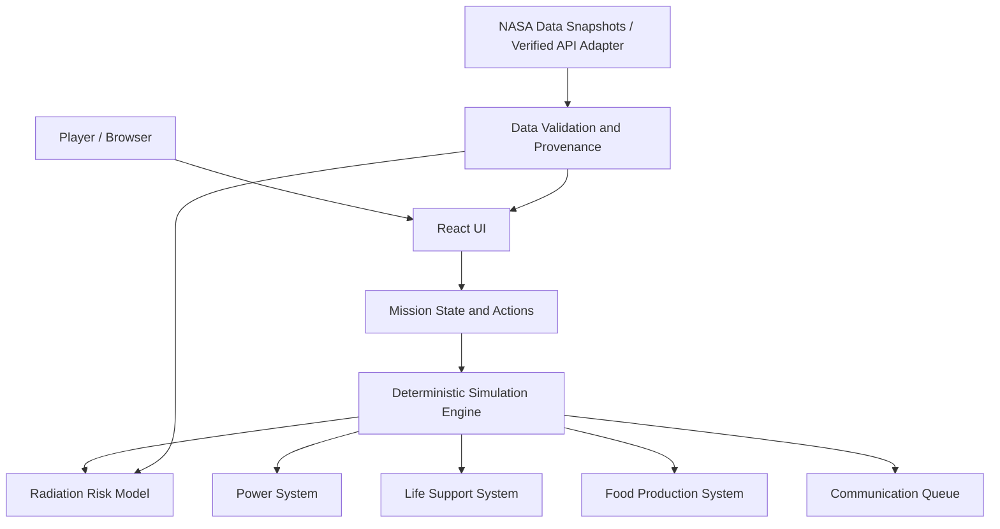

# RED HORIZON — Junior Astronaut Mission Trainer

**Live Demo:** `[ADD VERIFIED DEPLOYED URL HERE]`  
**Demo Video:** `[ADD LINK IF AVAILABLE]`  
**NASA Space Apps Challenge 2026 — Official Challenge:** [Build a Junior Astronaut Mission Trainer](https://www.spaceappschallenge.org/2026/challenges/junior-astronaut-mission-trainer/)

> Student-built hackathon project. Not an official NASA product and not endorsed by NASA.

## 1. Project Title & Problem Statement

**Project:** RED HORIZON — Junior Astronaut Mission Trainer  
**Official challenge:** Build a Junior Astronaut Mission Trainer.

[In 2–4 sentences, explain the problem: space education often hides or over-simplifies the real trade-offs needed to operate an outpost. Explain how this interactive simulation lets learners aged 7–12 manage power, life support, radiation risk, food production and communication delay, then observe consequences.]

## 2. Team Details

**Team name:** `[TEAM NAME]`

| Full name | Institution | GitHub username | Role / contribution |
|---|---|---|---|
| `[Member 1]` | `[Institution]` | `[@username]` | `[Actual role and contribution]` |
| `[Member 2]` | `[Institution]` | `[@username]` | `[Actual role and contribution]` |
| `[Member 3]` | `[Institution]` | `[@username]` | `[Actual role and contribution]` |
| `[Member 4]` | `[Institution]` | `[@username]` | `[Actual role and contribution]` |

[Add/remove rows to match the registered team. Do not invent members or contributions.]

## 3. Solution Overview & Architecture

### What it does

[Describe the actual implemented mission flow, resource systems, player decisions, delayed consequences and debrief. Do not list planned features as completed.]

### Architecture



[Update this diagram to match the final implementation.]

### Technology stack

- Frontend: `[ACTUAL]`
- Language: `[ACTUAL]`
- Styling/UI: `[ACTUAL]`
- Simulation: `[ACTUAL]`
- Data sources/adapters: `[ACTUAL]`
- Hosting: `[ACTUAL]`
- Testing: `[ACTUAL]`

### NASA data and scientific limitations

[List each dataset actually used, the records/fields, original units, retrieval date/time, transformations and limitations. Clearly distinguish observed data, published values, derived values and game assumptions.]

## 4. Live Demo & Screenshots

- **Live application:** `[VERIFIED URL]`
- **Demo video:** `[LINK OR “Not available”]`

### Screenshots

| Screen | Screenshot |
|---|---|
| Mission briefing | `[ADD SCREENSHOT]` |
| Command dashboard | `[ADD SCREENSHOT]` |
| Decision and consequences | `[ADD SCREENSHOT]` |
| Mission debrief / NASA data panel | `[ADD SCREENSHOT]` |

## 5. Installation & Setup Guide

### Requirements

- Node.js: `[VERSION TESTED]`
- npm: `[VERSION TESTED]`

### Run locally

```bash
git clone [PUBLIC_REPOSITORY_URL]
cd [REPOSITORY_FOLDER]
npm install
npm run dev
```

Open the local URL printed by Vite.

### Build and test

```bash
npm run build
npm run test
```

[Remove or adjust commands that are not present in package.json. Include any required environment configuration, but never include API keys or secrets.]

## 6. AI Usage Disclosure

We used generative AI assistance in accordance with the event handbook. AI tools were used as support; human team members reviewed, integrated, tested and are responsible for the submitted work.

| AI tool | Files/components/assets assisted | Nature of assistance | Human review, integration and testing |
|---|---|---|---|
| ChatGPT (OpenAI) | `[LIST ACTUAL FILES OR PLANNING/DOCS]` | Challenge analysis, research synthesis, architecture/prompt support and/or code assistance as actually used | `[STATE WHAT THE TEAM ACTUALLY VERIFIED, MODIFIED AND TESTED]` |
| `[Other tool, if used]` | `[ACTUAL FILES]` | `[ACTUAL HELP]` | `[HUMAN WORK]` |

**AI-generated assets:** `[List every generated image/audio/video/design asset and where used, or state “None”.]`

**Human contributions:** `[State the modules, integration, debugging, testing, design and research completed by each team member. Be precise and do not claim AI-generated work was written entirely by a human.]`

AI tools are not Git authors or repository contributors. All commits were authored and pushed by registered human team members using their own GitHub accounts.
